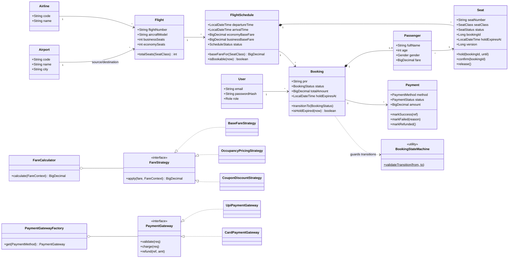
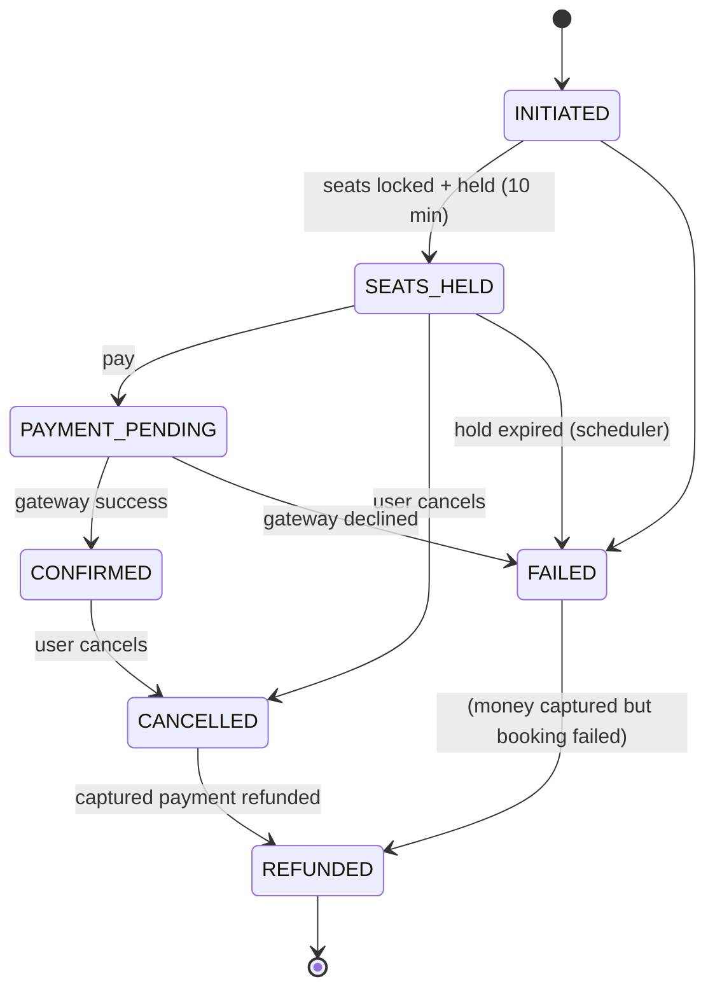
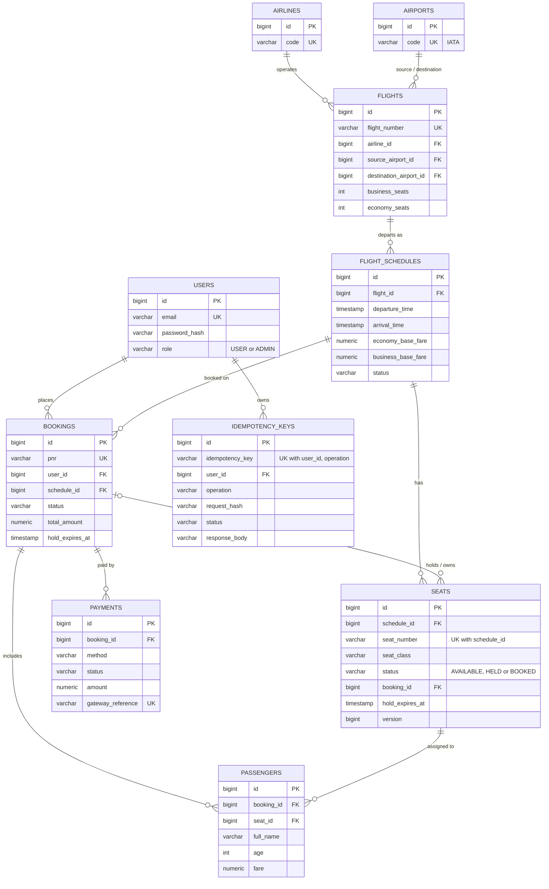

# Flight Booking System (Cleartrip-style backend)

A production-shaped backend for searching flights, holding seats, booking, paying and cancelling,
built with **Java 17, Spring Boot 3.3, Spring Data JPA/Hibernate, PostgreSQL, Flyway, Spring Security (JWT),
Spring Cache (Redis) and JUnit 5 / Mockito**.

The project focuses on **Low Level Design** (OOP, SOLID, design patterns, schema design), **correctness
under concurrency** (no double booking) and **tests** (91 automated tests: 62 unit and 29 integration).

---

## 1. Problem statement

Design the backend of an online flight booking platform where:

1. Admins manage inventory: airports, airlines, flights (route + cabin layout) and dated **schedules**.
   Creating a schedule auto-generates its seat map.
2. Anyone can **search** flights by origin, destination, date and passenger count, filter by price range
   and airline, sort by price, duration or departure, and paginate.
3. A logged-in user picks seats; the system **holds** them for **10 minutes** while the user pays.
   Two users must never get the same seat, even when they click at the same millisecond.
4. The user pays via **UPI or CARD** (mock gateways). Network retries must not create duplicate bookings
   or charge twice (**Idempotency-Key**).
5. A booking follows an explicit lifecycle; illegal moves (paying a cancelled booking, for example) are rejected.
6. Unpaid holds expire automatically and seats go back to inventory.
7. Users can cancel; cancelling a confirmed booking refunds the payment.
8. Users get (mock) email/SMS notifications on important state changes.

## 2. Architecture

```
controller  ->  service  ->  repository  ->  PostgreSQL (Flyway-managed schema)
    |             |   \
   dto        pattern  domain (entities with behaviour + invariants)
 (records +   (state, strategy, factory, observer)
 validation)
config (security, cache, async, scheduling, OpenAPI, correlation-id filter, seed data)
exception (typed business exceptions + global handler -> structured JSON)
security (JWT service + filter, principal, JSON 401/403 handlers)
```

```
src/main/java/com/kunal/flightbooking
├── FlightBookingApplication.java
├── config/       SecurityConfig, CacheConfig, AsyncConfig (MDC TaskDecorator), SchedulingConfig,
│                 ClockConfig, OpenApiConfig, CorrelationIdFilter, JwtProperties, BookingProperties, DevDataSeeder
├── controller/   AuthController, FlightController, BookingController, AdminController
├── domain/       Airport, Airline, Flight, FlightSchedule, Seat, User, Passenger, Booking, Payment,
│                 IdempotencyRecord + enums (SeatClass, SeatStatus, BookingStatus, PaymentMethod, ...)
├── dto/          request/ (Bean Validation records), response/ (API records), mapper/DtoMapper
├── exception/    BusinessException hierarchy, ErrorResponse, GlobalExceptionHandler
├── pattern/
│   ├── state/    BookingStateMachine
│   ├── strategy/ FareStrategy, BaseFareStrategy, OccupancyPricingStrategy, CouponDiscountStrategy,
│   │             Coupon, FareContext, FareCalculator
│   ├── factory/  PaymentGateway, UpiPaymentGateway, CardPaymentGateway, PaymentGatewayFactory
│   └── observer/ BookingEvent, EmailNotificationListener, SmsNotificationListener
├── repository/   Spring Data JPA repositories (JPQL fetch joins, GROUP BY, FOR UPDATE, native SQL report)
├── security/     JwtService, JwtAuthenticationFilter, AuthUser, AppUserDetailsService, JsonSecurityErrorHandler
└── service/      AuthService, AdminService, FlightSearchService, BookingService, PaymentService,
                  IdempotencyService, IdempotencyStore, SeatLayoutGenerator, FlightSearchCriteria,
                  scheduler/HoldExpiryScheduler, scheduler/SearchCacheEvictionScheduler
```

## 3. Class diagram



### Booking state machine



Any other move throws `InvalidStateTransitionException`, which the API returns as `409 INVALID_STATE_TRANSITION`.

## 4. ER diagram



Schema highlights (`src/main/resources/db/migration/V1__create_schema.sql`):

* **CHECK constraints** for every enum column, positive fares, `arrival_time > departure_time`, age range,
  and a seat-ownership invariant: an `AVAILABLE` seat has no booking, a `HELD` seat has a booking and an
  expiry, and a `BOOKED` seat has a booking and no expiry. The database rejects corrupt states even if
  application code has a bug.
* **Unique constraints**: `(schedule_id, seat_number)`, `(flight_id, departure_time)`, `pnr`,
  `(idempotency_key, user_id, operation)`.
* **Indexes chosen for the actual queries**: `seats(schedule_id, status, seat_class)` for availability
  GROUP BY, `bookings(status, hold_expires_at)` for the expiry job, `flights(source, destination)` and
  `flight_schedules(departure_time, status)` for search, `bookings(user_id, created_at)` for "my bookings".
* Hibernate runs with `ddl-auto=validate`: Flyway owns the schema and Hibernate only verifies it.

## 5. Design patterns

| Pattern | Where | Why |
|---|---|---|
| **State (table-driven state machine)** | `pattern/state/BookingStateMachine`, `Booking.transitionTo()` | All lifecycle rules live in one immutable `EnumMap`, so they are easy to audit and test exhaustively. `Booking.status` has no setter, so no code path can skip the guard. |
| **Strategy + Composite pipeline** | `pattern/strategy/*`, `FareCalculator` | Base fare, occupancy-based dynamic pricing and coupon discount are separate strategies applied in `@Order`. A new rule (festive surcharge, for example) is a new bean, with no edits to existing code (Open/Closed). |
| **Factory** | `pattern/factory/PaymentGatewayFactory` | Resolves `UPI`/`CARD` gateways from an `EnumMap` built by Spring list injection. There are no `switch` statements, and adding NETBANKING means adding one class. |
| **Observer** | `pattern/observer/*` via Spring `ApplicationEventPublisher` + `@TransactionalEventListener` + `@Async` | Booking code publishes a `BookingEvent` and does not know about email or SMS. Listeners run **after commit** (no notification for a rolled-back booking) and asynchronously (a slow provider never blocks checkout). |
| **Repository** | `repository/*` (Spring Data JPA) | Persistence is isolated behind interfaces, which makes services easy to mock in unit tests. |
| **DTO + Mapper** | `dto/*`, `DtoMapper` | Entities never leave the service layer. The API contract is decoupled from the schema, and lazy-loading leaks are avoided (`open-in-view=false`). |
| **Template-like idempotency wrapper** | `IdempotencyService.execute(..., Supplier<T>)` | One reusable reserve, execute, then store-or-release flow wraps both booking creation and payment. |
| **Dependency Injection / DIP** | Everywhere, plus an injected `java.time.Clock` | Services depend on abstractions (gateways, strategies, Clock), so time-dependent logic is deterministic in tests. |

SOLID in practice: single-responsibility services (search, booking, payment and idempotency are separate),
Open/Closed strategies and gateways, Liskov-safe `PaymentGateway` implementations, small focused interfaces,
and dependency inversion through constructor injection.

## 6. Concurrency strategy: why pessimistic locking

**Choice: `@Lock(LockModeType.PESSIMISTIC_WRITE)` (SELECT ... FOR UPDATE) on the requested seat rows**,
with `@Version` on `Seat` as a second line of defence.

```java
@Lock(LockModeType.PESSIMISTIC_WRITE)
@QueryHints(@QueryHint(name = "jakarta.persistence.lock.timeout", value = "5000"))
@Query("select s from Seat s where s.id in :ids order by s.id")
List<Seat> findAllByIdForUpdate(@Param("ids") Collection<Long> ids);
```

Why pessimistic rather than optimistic:

* **High contention is the normal case** for seat selection (popular flight, last few seats, the front
  rows). With optimistic locking, every loser does all the work, fails at commit with
  `OptimisticLockException` and must retry, which creates retry storms exactly when load peaks.
  With a row lock, losers wait a few milliseconds, then read the committed `HELD` state and fail fast
  with a clean `409 SEAT_UNAVAILABLE`.
* **The critical section is tiny**: lock N seat rows, check status, update, commit. No external calls
  happen while seat locks are held, so lock hold time is a few milliseconds.
* **Locks are fine-grained**: they are per seat, not per flight, so users booking different seats on the
  same flight never block each other.
* **No deadlocks**: rows are always locked in primary-key order (`order by s.id`), so two bookings with
  overlapping seat sets acquire locks in the same order.
* A **lock timeout** bounds waiting, and lock failures map to `409 CONCURRENT_MODIFICATION`.
* `@Version` on `Seat` additionally catches any write path that forgets to lock.

Other races that are handled:

* **Pay vs. cancel vs. hold-expiry** on the same booking: each locks the **booking row** (`findByIdForUpdate`)
  and re-checks state under the lock, so the scheduler cannot expire a booking that is being paid.
* **Duplicate requests (double-click or client retry)**: an `idempotency_keys` row with a unique key is
  inserted in its own transaction *before* the work starts, so only one concurrent request can win the
  insert. The others replay the stored response (`Idempotent-Replayed: true`) or get `409 REQUEST_IN_PROGRESS`.
  Reusing a key with a different body returns `422`.
* **Hold expiry**: `HoldExpiryScheduler` (`@Scheduled`, every 30s) finds `SEATS_HELD` bookings with
  `hold_expires_at <= now` through an index, then expires each one in its **own transaction**, so one bad
  row cannot roll back the batch. Payment also rejects an expired hold (`410 HOLD_EXPIRED`) even if the
  job has not run yet.

**Proof**: `SeatHoldConcurrencyIT` releases 12 threads at once (via a `CountDownLatch`) to hold the
same seat, repeated 3 times. It asserts that exactly one booking succeeds, the other 11 fail with
`SeatUnavailableException`, and the seat is `HELD` by the winner.

## 7. Search and caching

* One JPQL query with `join fetch` (flight, airline, airports) avoids N+1 queries, and one `GROUP BY`
  query returns available seats per schedule and cabin.
* Fares are **dynamic** (they depend on occupancy), so price filtering, sorting and pagination happen in
  memory over the candidate set. A route has tens of departures per day, so this is cheap. Tie-breakers
  (departure, then id) keep pages stable.
* `@Cacheable("flightSearch")` is keyed by the normalised criteria record. The provider is chosen by
  profile: **simple in-memory** cache by default and in tests, **Redis with a 60s TTL** in docker-compose.
  Search results are `Serializable` for Redis. Creating a schedule evicts the cache, and a scheduled
  eviction bounds staleness for the TTL-less in-memory cache. The cached seat count is only advisory;
  the seat lock at booking time is the source of truth.

## 8. API

Swagger UI: `http://localhost:8080/swagger-ui.html`. OpenAPI JSON: `/v3/api-docs`.

| Method | Path | Auth | Description |
|---|---|---|---|
| POST | `/api/auth/register` | public | Register (role USER), returns JWT |
| POST | `/api/auth/login` | public | Login, returns JWT |
| GET | `/api/flights/search` | public | `from,to,date,passengers,seatClass,minPrice,maxPrice,airlines,sortBy(PRICE/DURATION/DEPARTURE),direction,page,size` |
| GET | `/api/schedules/{id}/seats` | public | Seat map with status |
| GET | `/api/airports` | public | List airports |
| POST | `/api/bookings` | USER | **Idempotency-Key** required. Creates a booking and holds seats for 10 min |
| GET | `/api/bookings` | USER | My bookings |
| GET | `/api/bookings/{id}` | USER | Booking details (owner only) |
| POST | `/api/bookings/{id}/payments` | USER | **Idempotency-Key** required. Pay via UPI/CARD |
| POST | `/api/bookings/{id}/cancel` | USER | Cancel (refund if confirmed) |
| POST | `/api/admin/airports` | ADMIN | Create airport |
| POST | `/api/admin/airlines` | ADMIN | Create airline |
| POST | `/api/admin/flights` | ADMIN | Create flight (route + cabin layout) |
| POST | `/api/admin/schedules` | ADMIN | Create schedule; seats auto-generated |
| GET | `/api/admin/reports/route-revenue` | ADMIN | Revenue per route (native SQL: joins + GROUP BY) |
| GET | `/actuator/health` | public | Health check |

Every error has the same shape:

```json
{
  "timestamp": "2026-10-20T15:02:11.120Z",
  "status": 409,
  "error": "Conflict",
  "code": "SEAT_UNAVAILABLE",
  "message": "Seat 4A is no longer available",
  "path": "/api/bookings",
  "correlationId": "5b0f3c2e-8d7a-4f0e-9a51-0c1a3e9f7b11"
}
```

Validation errors also include `fieldErrors: [{field, message}]`. Every response carries `X-Correlation-Id`
(the client's value is echoed if it sends one), and the same id appears on every log line through the MDC,
including async notification threads.

### Sample curl session

```bash
BASE=http://localhost:8080

# 1. Register and capture the token
TOKEN=$(curl -s -X POST $BASE/api/auth/register -H 'Content-Type: application/json' \
  -d '{"fullName":"Kunal Kumar","email":"kunal@example.com","password":"Choose-a-strong-pass1","phone":"9876543210"}' \
  | jq -r .accessToken)

# 2. Search DEL -> BOM tomorrow for 2 passengers, cheapest first, IndiGo or Air India only
curl -s "$BASE/api/flights/search?from=DEL&to=BOM&date=$(date -d tomorrow +%F)&passengers=2&sortBy=PRICE&airlines=6E,AI&maxPrice=6000&page=0&size=5" | jq

# 3. Seat map of a schedule
curl -s $BASE/api/schedules/1/seats | jq '[.[] | select(.status=="AVAILABLE")][0:3]'

# 4. Hold seats (creates booking in SEATS_HELD for 10 minutes)
curl -s -X POST $BASE/api/bookings -H "Authorization: Bearer $TOKEN" \
  -H "Idempotency-Key: $(uuidgen)" -H 'Content-Type: application/json' \
  -d '{"scheduleId":1,"couponCode":"FLY10","passengers":[
        {"fullName":"Kunal Kumar","age":24,"gender":"MALE","seatId":13},
        {"fullName":"Priya Kumar","age":23,"gender":"FEMALE","seatId":14}]}' | jq

# 5. Pay (UPI). Use upiId "fail@okaxis" or cardToken "tok_fail" to simulate a decline
curl -s -X POST $BASE/api/bookings/1/payments -H "Authorization: Bearer $TOKEN" \
  -H "Idempotency-Key: pay-$(uuidgen)" -H 'Content-Type: application/json' \
  -d '{"method":"UPI","upiId":"kunal@okaxis"}' | jq
#    or card: -d '{"method":"CARD","cardToken":"tok_visa_4242"}'

# 6. Cancel: CONFIRMED -> CANCELLED -> REFUNDED
curl -s -X POST $BASE/api/bookings/1/cancel -H "Authorization: Bearer $TOKEN" | jq .status

# 7. Admin (requires SEED_ADMIN_PASSWORD to have been set when the dev profile started)
ADMIN=$(curl -s -X POST $BASE/api/auth/login -H 'Content-Type: application/json' \
  -d "{\"email\":\"admin@flightbooking.local\",\"password\":\"$SEED_ADMIN_PASSWORD\"}" | jq -r .accessToken)
curl -s -X POST $BASE/api/admin/flights -H "Authorization: Bearer $ADMIN" -H 'Content-Type: application/json' \
  -d '{"flightNumber":"6E999","airlineCode":"6E","sourceCode":"BLR","destinationCode":"HYD","aircraftModel":"A321neo","businessSeats":8,"economySeats":180}'
curl -s -X POST $BASE/api/admin/schedules -H "Authorization: Bearer $ADMIN" -H 'Content-Type: application/json' \
  -d '{"flightId":10,"departureTime":"2026-12-01T07:00:00","arrivalTime":"2026-12-01T08:15:00","economyBaseFare":3499,"businessBaseFare":9999}'
curl -s $BASE/api/admin/reports/route-revenue -H "Authorization: Bearer $ADMIN" | jq
```

Coupons available: `FLY10` (10% off, capped at INR 500 per passenger), `FIRSTFLIGHT` (15%, capped at 1000)
and `FLAT300`. Dynamic pricing: the fare is multiplied by x1.15 at 50% occupancy, x1.30 at 75% and x1.50 at 90%.

## 9. How to run

**Prerequisites:** JDK 17. Maven is optional because `./mvnw` downloads it. Docker is only needed for compose.

```bash
# Build + all tests (unit tests via Surefire, *IT integration tests via Failsafe, JaCoCo report)
./mvnw verify

# Run locally with zero infrastructure: H2 (PostgreSQL mode) + seed data
SEED_ADMIN_PASSWORD='pick-a-local-password' ./mvnw spring-boot:run -Dspring-boot.run.profiles=local,dev
# Swagger: http://localhost:8080/swagger-ui.html   H2 console: http://localhost:8080/h2-console

# Full stack: app + PostgreSQL + Redis
cp .env.example .env      # fill in JWT_SECRET, POSTGRES_PASSWORD, optionally SEED_ADMIN_PASSWORD
docker compose up --build
```

| Profile | Purpose |
|---|---|
| *(default)* | PostgreSQL via `DB_URL`/`DB_USERNAME`/`DB_PASSWORD`, simple in-memory cache |
| `local` | In-memory H2 in PostgreSQL mode, so no database install is needed |
| `dev` | Loads seed data: DEL, BOM, BLR, MAA, HYD, CCU; IndiGo, Air India, Akasa; 9 routes x 7 days |
| `docker` | PostgreSQL + Redis cache (60s TTL), used by docker-compose |
| `test` | H2 (PostgreSQL mode), scheduling disabled so jobs are triggered deterministically |

Secrets are never hard-coded. The JWT key comes from `JWT_SECRET` (the default in `application.yml`
is a clearly labelled local-only placeholder), and the admin account is only seeded when
`SEED_ADMIN_PASSWORD` is provided.

## 10. Tests

`./mvnw verify` runs **91 tests** (62 unit + 29 integration):

| Suite | Type | What it covers |
|---|---|---|
| `BookingStateMachineTest` | unit | Every valid transition, invalid transitions, no self-loops, terminal state |
| `FareStrategyTest` | unit | Base fare, each occupancy tier, coupon cap/flat/unknown, ordering and extensibility |
| `PaymentGatewayFactoryTest` | unit | Factory resolution, duplicate registration, UPI/CARD validation and decline |
| `SeatTest` | unit | Seat hold/confirm/release invariants |
| `BookingServiceTest` | unit (Mockito) | Hold flow and pricing, held seat, duplicate seats, departed flight, cancel+refund, expiry |
| `PaymentServiceTest` | unit (Mockito) | Success, decline, invalid details, double pay, expired hold, ownership |
| `FlightSearchIT` | integration | Date window, sorting (price/duration/departure), price and airline filters, pagination, cabin, validation |
| `BookingFlowIT` | integration | Hold, idempotent replay / key reuse, double hold, pay, double pay, decline, cancel/refund, ownership, events |
| `SecurityAndAdminIT` | integration | Register/login, 401/403 JSON, correlation id, admin inventory + seat generation, revenue report, OpenAPI |
| `HoldExpiryIT` | integration | Scheduler expires only stale holds, expired hold can't be paid, seat re-bookable |
| `SeatHoldConcurrencyIT` | integration | 12 parallel threads, same seat, exactly one winner (x3) |

Integration tests use H2 in PostgreSQL mode with the same Flyway migrations as production.
Testcontainers was deliberately left out because the build environment has no Docker. Adding a
`PostgreSQLContainer`-based profile would be the next step.

## 11. Trade-offs and next steps

* Payment gateways are synchronous mocks. A real integration would use an async callback/webhook plus an
  **outbox** table, so the gateway call does not run inside the DB transaction.
* Idempotency records should be purged after about 24h (there is an index on `created_at`; the job is not
  implemented yet).
* The seat count in search is cached and advisory; correctness is enforced only at hold time.
* Fare quotes are not locked between search and booking (the price is recomputed at hold time).
